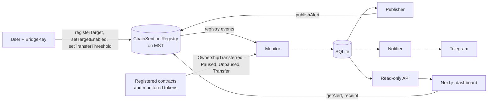

# ChainSentinel

Explainable, verifiable on-chain risk monitoring, built on MST Blockchain.

ChainSentinel watches contracts and treasury addresses that you register in an MST smart contract, turns supported on-chain events into **rule-based alerts with transaction-level evidence**, and publishes a hash of each alert's evidence to the same contract so anyone can verify it independently. It is an observation and audit tool, not a security guarantee (see [Limitations](#limitations)).

## Status

| Component | State |
|---|---|
| `ChainSentinelRegistry.sol` | Implemented. 48 Foundry tests (36 for the registry, 12 for the test fixture). Deployed on MST Testnet. |
| MST Mainnet deployment | **Not done yet.** No mainnet address exists; none is claimed here. |
| Monitor and rules engine | Implemented and run live against MST Testnet. |
| Audit-record publisher | Implemented and run live against MST Testnet. |
| Dashboard with BridgeKey | Implemented. Wallet connection, target registration and management, alert explanations and on-chain verification. |
| Telegram notifications | Implemented and run live. |
| Contract source verification on MSTScan | Not done yet. |
| Public hosted demo | **Not done yet.** The dashboard currently runs locally. |
| Independent security audit | None. |

Measured results come from scripted scenario runs on MST Testnet and are on a generated page: [docs/EVIDENCE.md](docs/EVIDENCE.md).

## How it works

1. A user connects BridgeKey and registers an address with a large-transfer threshold. The registration is a transaction to the registry contract and emits events.
2. The monitor reads the registry's events and the supported events of each registered address, after a confirmation delay, and stores them in SQLite.
3. Deterministic rules turn events into alerts. Each alert keeps three things apart: the observed fact, the rule-based assessment, and what the alert does not show. The evidence is canonical JSON, and its keccak256 hash identifies it.
4. An authorized reporter publishes `(alertId, targetId, evidenceHash, severity)` to the registry. A duplicate alert id is rejected by the contract.
5. The dashboard shows the alert, its explanation, the source transaction and the audit-record transaction, and can re-check the on-chain record in the browser.
6. Optionally, a notifier sends the alert to Telegram.

A published record proves that it was submitted and included on-chain. It does not prove that the alert is correct or that an attack occurred.

More detail: [docs/ARCHITECTURE.md](docs/ARCHITECTURE.md), [docs/RULES.md](docs/RULES.md), [docs/SECURITY.md](docs/SECURITY.md).

## MST integration

| Aspect | Detail |
|---|---|
| Networks | Testnet: chain ID 91562037, tMSTC, RPC `https://testnetrpc.mstblockchain.com`, explorer `https://testnet.mstscan.com`. Mainnet: chain ID 4646, MSTC, RPC `https://mariorpc.mstblockchain.com/`, explorer `https://mstscan.com`. |
| Contract | Solidity 0.8.24, compiled for the `paris` EVM target as a conservative choice. Newer opcodes were not tested on MST. |
| Wallet | BridgeKey, discovered through EIP-6963 (`io.bridgekey.wallet`). Registration and target management are signed in the wallet, and the wallet chooses the fees. Verified on testnet. |
| Observed RPC behaviour | Blocks about every 3 s. `eth_getLogs` with address and topic filters works over large ranges (tested up to 200,000 blocks with topic filters). The `safe` and `finalized` block tags return block 0, so the monitor uses a configurable confirmation depth instead. The node rejected a transaction with a priority fee below 1 gwei. |
| On-chain role | The registry is the source of truth for what is monitored (targets, thresholds, enabled flags) and the append-only log of alert records. |

## Deployments

### MST Testnet (development deployment)

| Item | Value |
|---|---|
| Registry contract | [0xC9f3D85De752a4112c6399c2bB6eb7f06697d945](https://testnet.mstscan.com/address/0xC9f3D85De752a4112c6399c2bB6eb7f06697d945) |
| Deployment transaction | [0xce18ba40…c00e5](https://testnet.mstscan.com/tx/0xce18ba40233a35f802c9e28d70c9e40dcef1c8a453782c5c831eb983fb1c00e5) |
| `registerTarget` (CLI account) | [0x1e318dc6…d981](https://testnet.mstscan.com/tx/0x1e318dc62a80fe69fda3ad7eca094b2e4ca327d6cc4cf853a0c67a04ad09d981) |
| `publishAlert` (smoke test, not a real detection) | [0x0e37bee6…90e1](https://testnet.mstscan.com/tx/0x0e37bee65e921a046a152103a88ec8c403449e2b42629d6106630ed59add90e1) |
| `registerTarget` signed through BridgeKey | [0x1807fcba…e27d](https://testnet.mstscan.com/tx/0x1807fcba5ff07f93e514e62a1dd61fcd7157a02856d6774f4d90f881f23ae27d) |
| Admin (BridgeKey account) | `0x52A1404119C7119986b8149f155B9bC1254F1047` |
| Reporter | `0xd42C15c727D8Af7D88524E4164B010d31158D793` |
| Deployer (no special authority) | `0x6e377DD5C5D55c25094BaeFf4eeE736ee4097d4e` |
| Test fixture token (not part of the product) | `0x58e42c5f3472f10d350aba6d5bff1b82bc50a28c` |

More transactions and notes: [docs/deployments/mst-testnet.md](docs/deployments/mst-testnet.md).

### MST Mainnet

Not deployed yet. The address and transaction will be added here after deployment, together with the testnet-equivalent checks.

## Quick start

Requirements: Node.js 24 (see `.nvmrc`) and [Foundry](https://book.getfoundry.sh/).

    git clone --recurse-submodules https://github.com/HrishiBanait/Chain-Sentinel.git
    cd Chain-Sentinel

Run the tests:

    (cd contracts && forge test)
    (cd backend && npm ci && npx tsc --noEmit && npm test)
    (cd frontend && npm ci && npm run build)

Run the pipeline read-only against the public testnet deployment (no keys needed):

    cp .env.example .env
    # in .env set:
    #   MST_TESTNET_REGISTRY_ADDRESS=0xC9f3D85De752a4112c6399c2bB6eb7f06697d945
    #   MST_TESTNET_DEPLOY_BLOCK=<output of: cast receipt 0xce18ba40233a35f802c9e28d70c9e40dcef1c8a453782c5c831eb983fb1c00e5 blockNumber --rpc-url https://testnetrpc.mstblockchain.com>
    cd backend
    npm run monitor      # terminal 1
    npm run api          # terminal 2
    cd ../frontend && npm run dev     # terminal 3, then open http://localhost:3000

The publisher (`npm run publish`) needs a reporter keystore that is authorized on the registry, and the notifier (`npm run notify`) needs a Telegram bot. Both are optional for reading data. All settings are documented in [docs/ARCHITECTURE.md](docs/ARCHITECTURE.md#configuration).

## Verify an alert yourself

Every alert on the dashboard has a "Check it without this page" block. In essence:

    cast call <registry> "getAlert(bytes32)((uint256,bytes32,uint8,address,uint64))" <alertId> --rpc-url <rpc>
    cast receipt <audit-record tx> --rpc-url <rpc>
    cast keccak '<the exact evidence text shown on the alert>'

The second field of the on-chain record must equal the keccak256 of the evidence text.

## Limitations

- Coverage is limited to the supported event signatures (OpenZeppelin-style ownership and pause events, ERC-20 `Transfer`), registered addresses and monitored tokens. See [docs/RULES.md](docs/RULES.md).
- Alerts are observations with rule-based assessments, not findings of malicious activity.
- Large-transfer thresholds are raw token units and apply to a global list of monitored tokens.
- Registration is permissionless, and the backend does not yet cap how many targets it monitors or how much the reporter spends. See [docs/SECURITY.md](docs/SECURITY.md).
- The contract is not upgradeable and has not been independently audited.
- Single-instance design with a SQLite database.

## Documentation

[Architecture](docs/ARCHITECTURE.md) · [Detection rules](docs/RULES.md) · [Security model](docs/SECURITY.md) · [Evidence](docs/EVIDENCE.md) · [Roadmap](docs/ROADMAP.md) · [Demo script](docs/DEMO.md)

## License

MIT, see [LICENSE](LICENSE).
