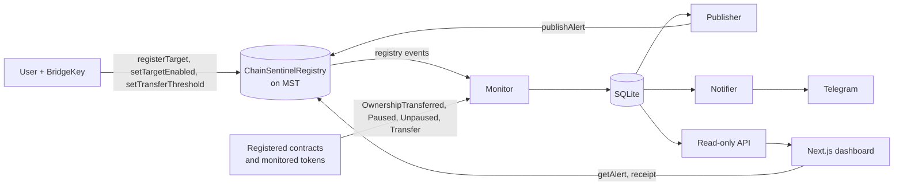

# Architecture

## Overview

## Processes

Each process is independent and communicates only through the SQLite file and the chain, so one failing does not stop the others.

| Process | Command (in `backend/`) | Responsibility | Writes |
|---|---|---|---|
| Monitor | `npm run monitor` | Reads logs, applies rules, creates alerts | events, alerts, target_config, checkpoints, block_hashes, metrics |
| Publisher | `npm run publish` | Publishes audit records and re-checks them | publish_log, alert status |
| Notifier | `npm run notify` | Sends Telegram messages and retractions | notify_log |
| API | `npm run api` | Read-only HTTP access to the data | nothing |
| Dashboard | `npm run dev` in `frontend/` | UI, wallet actions, in-browser verification | nothing |

Run a single instance of the publisher and of the notifier. Heartbeats are stored in `schema_meta` so the API can report whether each process is running.

## Event-to-alert pipeline

1. **Chain check.** The monitor refuses to run if the RPC reports a different chain ID, and the database is bound to one chain and registry address.
2. **Confirmation depth.** Only blocks at least `MONITOR_CONFIRMATIONS` (default 12, about 36 s on testnet) behind the head are processed. This is a configured policy, not a measured finality guarantee, because the node's `safe` and `finalized` tags return block 0.
3. **Three server-side-filtered queries per batch** (default 2,000 blocks): registry events; ownership and pause events emitted by registered addresses; and ERC-20 `Transfer` logs of the monitored tokens where a registered address is sender or recipient. An unfiltered scan is not viable on testnet because of log volume.
4. **Range errors** split the query in half. Transient RPC errors retry with backoff.
5. **Atomic commit.** A batch's events, alerts and checkpoint are committed in one SQLite transaction, after checking that the batch's last block hash did not change during the scan.
6. **Position-aware configuration.** Each event is judged against the target's configuration (enabled, threshold) as of that event's block and log index, taken from the registry's event history, not the latest state.
7. **Reorganizations.** The monitor stores batch-end block hashes and compares the checkpoint with the chain. On a mismatch it rolls back to the last matching batch end, deletes unpublished alerts from orphaned events and marks published ones `orphaned`.
8. **Deduplication.** Logs are unique by chain ID, transaction hash and log index. Alert IDs are deterministic (below), so a replay cannot create a second alert.

Monitoring of an address starts when its registration is seen. Events before that are not fetched.

## Alert identity and evidence

-eccak256(abi.encode(chainId, txHash, logIndex, keccak256(ruleId), targetId))`.
- Evidence: canonical JSON (sorted keys, no whitespace, bigints as strings) containing the schema version, chain, rule id and version, target, the decoded event with its block and transaction, and rule details. Its keccak256 is the evidence hash.
- Each alert stores `observed` (fact), `assessment` (rule-based judgement) and `caveat` (what it does not show) as separate fields.

## Publishing audit records

For each eligible alert (`status = new`, severity at least `PUBLISH_MIN_SEVERITY`) the publisher:

1. asks the contract whether the alert ID already exists, and records the existing transaction instead of sending a duplicate if it does (crash recovery);
2. simulates `publishAlert` and classifies a revert: `TargetDisabled` marks the alert `skipped`, `NotReporter` stops the publisher, `AlertAlreadyPublished` triggers the recovery path;
3. sends the transaction and stores its hash **before** waiting for the receipt;
4. reads the record back and compares its evidence hash with the stored one;
5. after the confirmation depth, re-reads the record and returns the alert to `new` if it disappeared (reorg), or marks it `failed` if the on-chain hash differs.

Transient failures retry with exponential backoff up to `PUBLISH_MAX_ATTEMPTS`. The reporter key is read from an encrypted keystore (see [SECURITY.md](SECURITY.md)).

## Notifications

The notifier sends one Telegram message per alert (observed, assessment and caveat separately, plus a source-transaction link). Delivery is at-least-once. It handles flood control (`retry_after`), classifies errors, stops on misconfiguration, skips alerts whose source event is older than `NOTIFY_MAX_AGE_SECS` unless run with `--backfill`, and sends a follow-up retraction if a reorg removes an alert that was already announced.

## Read API

GET only, read-only SQLite access, bound to `127.0.0.1` by default, with a CORS allowlist.

| Endpoint | Returns |
|---|---|
| `/api/health` | Monitor and publisher status, checkpoint lag, counts, counters |
| `/api/config` | Network, chain ID, registry, explorer, confirmations, monitored tokens |
| `/api/targets` | Targets with the latest configuration and alert counts |
| `/api/alerts` | Alerts, newest first (`limit`, `offset`, `targetId`, `minSeverity`, `includeOrphaned`) |
| `/api/alerts/:id` | One alert with the exact evidence text and a hash check |

## Dashboard and verification

The dashboard discovers wallets through EIP-6963 and selects BridgeKey by its `rdns`. It never falls back to `window.ethereum`. Writes (`registerTarget`, `setTargetEnabled`, `setTransferThreshold`) are signed in the wallet with wallet-chosen fees. Reads come from the API.

"Verify on MST" in the browser checks that the evidence text hashes to the alert's hash, that the registry holds a record with the same evidence hash, target and severity, that the publishing transaction succeeded, went to the registry and was sent by the record's reporter, and that its `AlertPublished` event matches. It reads through the public RPC directly if the browser allows it, otherwise through the connected wallet, and always offers equivalent `cast` commands.

## Data model

`schema_meta` (identity, heartbeats), `checkpoints`, `block_hashes`, `target_config` (configuration history per target), `events`, `alerts`, `metrics` (counters), `publish_log`, `notify_log`.

## Configuration

Set in `.env` at the repository root (see `.env.example`). The frontend reads `NEXT_PUBLIC_API_URL` from `frontend/.env.local`.

| Variable | Meaning |
|---|---|
| `MST_TESTNET_*`, `MST_MAINNET_*` | RPC URL, chain ID, explorer, and after deployment the registry address, deploy block, admin and reporter addresses |
| `MONITOR_NETWORK` | `testnet` or `mainnet` |
| `MONITOR_START_BLOCK` | First block to scan (defaults to the registry's deploy block) |
| `MONITOR_CONFIRMATIONS` | Confirmation depth, default 12 |
| `MONITOR_BATCH_SIZE`, `MONITOR_POLL_INTERVAL_MS` | Scan batch size (2000) and poll interval (6000) |
| `MONITOR_TOKENS` | Comma-separated ERC-20 addresses the large-transfer rule applies to; empty disables it |
| `MONITOR_DB_PATH` | SQLite file, default under `backend/data/` |
| `API_HOST`, `API_PORT`, `API_ALLOWED_ORIGINS` | API binding and CORS allowlist |
| `REPORTER_KEYSTORE_PATH`, `REPORTER_PASSWORD_FILE` | Encrypted keystore and optional password file (otherwise a hidden prompt) |
| `REPORTER_FEE_MODE`, `REPORTER_MIN_TIP_GWEI`, `REPORTER_GAS_PRICE_GWEI` | `auto` (estimate with a tip floor) or `legacy` (fixed gas price) |
| `PUBLISH_MIN_SEVERITY`, `PUBLISH_POLL_INTERVAL_MS`, `PUBLISH_MAX_ATTEMPTS`, `PUBLISH_PENDING_GRACE_SECS` | Publisher behaviour |
| `TELEGRAM_BOT_TOKEN` or `TELEGRAM_BOT_TOKEN_FILE`, `TELEGRAM_CHAT_ID` | Bot credentials and destination |
| `NOTIFY_MIN_SEVERITY`, `NOTIFY_MAX_AGE_SECS`, `NOTIFY_POLL_INTERVAL_MS`, `NOTIFY_MAX_ATTEMPTS`, `NOTIFY_DASHBOARD_URL` | Notifier behaviour (the dashboard link must be a public URL) |
| `SCENARIO_OWNER_KEYSTORE_PATH`, `SCENARIO_GAS_PRICE_GWEI` | Scenario runner (testnet only) |

## Design decisions

- Observations and assessments are stored and shown separately, so a reader can tell fact from judgement.
- Rules are deterministic and versioned. An alert's evidence records the rule version that produced it.
- Detail stays off-chain. Only the alert ID, target, severity and evidence hash go on-chain.
- Every stage is idempotent and crash-safe, because both the chain and the network fail halfway.
- Secrets never go in `.env` as raw keys: the reporter key lives in an encrypted keystore.
